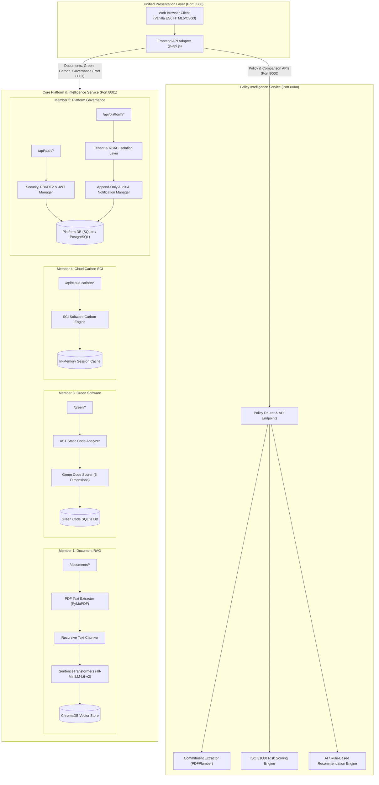

# Platform Architecture & Microservices Specification

This document provides the authoritative architectural specification for the **AI-Powered Enterprise ESG Sustainability Platform**.

---

## 1. Architectural Philosophy & Overview

The platform is designed around the principles of **modular microservices, multi-tenancy, defense-in-depth security, and deterministic offline resilience**:

1. **Separation of Concerns**: Specialised analytical workloads (PDF parsing/RAG, ISO 31000 risk engines, static code analysis, cloud SCI carbon accounting, and multi-tenant audit governance) operate as independent, bounded contexts.
2. **Dual-Backend Topology**:
   - **Port 8000**: Stateless Policy Intelligence microservice (`esg-cr/backend`).
   - **Port 8001**: Stateful Core Platform backend hosting Document RAG, Green Code Intelligence, Cloud Carbon SCI, and Enterprise Governance (`AI_ESG_Platform/backend`).
3. **Decoupled Frontend Adapter**: The unified web client on **Port 5500** communicates via an intelligent JavaScript API adapter layer (`js/api.js`) that transparently routes requests to either Port 8000 or Port 8001 while maintaining user session context and token authentication.
4. **Resilient Hybrid AI**: The system combines high-capability LLM reasoning (Google Gemini) with zero-external-dependency heuristic fallback engines, local sentence embeddings (`all-MiniLM-L6-v2`), and persistent local vector search (ChromaDB).

---

## 2. System Context & Top-Level Architecture



---

## 3. Module Breakdown & Responsibility Matrix

### 3.1 Member 1: Document Intelligence & RAG
- **Directory**: `AI_ESG_Platform/backend/app/routers/documents.py`, `app/services/`
- **Port**: 8001
- **Key Responsibilities**:
  - Ingestion and validation of corporate ESG PDF disclosures.
  - Text extraction using PyMuPDF (`fitz`).
  - Semantic sliding-window chunking (1000 characters with 200 character overlap).
  - Local vector embeddings generation using Hugging Face `all-MiniLM-L6-v2` (`SentenceTransformerEmbeddingFunction`).
  - Vector storage and cosine distance similarity search in ChromaDB (`chroma_db/esg_documents`).
  - Retrieval-Augmented Generation (RAG) synthesizing context chunks into structured responses via Google Gemini.

### 3.2 Member 2: Policy Intelligence & ISO 31000 Risk Engine
- **Directory**: `esg-enterprise-frontend-complete (2)/esg-enterprise-frontend-complete/esg-cr/backend/`
- **Port**: 8000
- **Key Responsibilities**:
  - Multi-policy comparison between baseline and revised corporate governance documents.
  - Commitment extraction (`commitment_extractor.py`) across Environmental, Social, and Governance categories.
  - Change classification: `STRENGTHENED`, `WEAKENED`, `UNCHANGED`, `NEW`, `REMOVED`, `MODIFIED`.
  - ISO 31000 compliant risk evaluation assigning likelihood, impact, and composite risk severity.
  - Recommendation engine generating actionable mitigation strategies.

### 3.3 Member 3: Green Software Intelligence
- **Directory**: `AI_ESG_Platform/backend/app/green/`
- **Port**: 8001
- **Key Responsibilities**:
  - Static AST-level inspection of software repositories and pull requests (`static_analysis.py`).
  - Detection of carbon-inefficient patterns: unindexed loops, repeated API queries, missing cache headers, synchronous I/O blocking, excessive payload serialization.
  - Green Code Score calculation normalized across 6 dimensions: Network, Database, Compute, Caching, CI/CD, Code Quality.
  - GitHub REST API integration with personal access tokens and standalone mock/demo mode.
  - Relational persistence in SQLite (`green_software.db`).

### 3.4 Member 4: Cloud Carbon & SCI Intelligence
- **Directory**: `AI_ESG_Platform/backend/app/cloud_carbon/`
- **Port**: 8001
- **Key Responsibilities**:
  - Ingestion and processing of cloud billing and compute usage datasets (AWS, Azure, Google Cloud).
  - Software Carbon Intensity (SCI) quantification following GSF (Green Software Foundation) standards.
  - Operational ($O$) and Embodied ($M$) emissions calculations:
    $$\text{SCI} = \frac{(E \times I) + M}{R}$$
  - Regional carbon intensity factors across geographic grid regions.
  - Session-scoped reporting and CSV/JSON data export.

### 3.5 Member 5: Enterprise Governance, Multi-Tenancy & Audit Engine
- **Directory**: `AI_ESG_Platform/backend/app/platform/`, `integrated-frontend/`
- **Port**: 8001 & 5500
- **Key Responsibilities**:
  - Secure authentication: PBKDF2-HMAC-SHA256 password hashing (100,000 iterations), constant-time verification, and HS256 JWT tokens.
  - Server-side token revocation tracking (`revoked_tokens` table).
  - Role-Based Access Control (`ADMIN`, `AUDITOR`, `DEVELOPER`, `VIEWER`).
  - Strict multi-tenant data isolation: all entity models (`Supplier`, `AuditLog`, `Notification`, etc.) are scoped to `organization_id`.
  - Supplier ESG lifecycle management (onboarding, categorization, scoring, and tier assignment).
  - Executive dashboard aggregating live data from all 5 members with honest availability reporting.
  - Enterprise PDF report generation using ReportLab with cryptographic SHA-256 integrity verification.
  - Append-only audit logging protected by database-level update/delete prevention triggers.
  - Per-user notification management with independent read status tracking (`NotificationRead` association).

---

## 4. Frontend Dual-Backend Routing Layer

The unified frontend on Port 5500 routes all outbound API calls through `integrated-frontend/js/api.js`. The routing architecture enforces strict microservice boundary isolation:

| Frontend API Method | Target Backend | Port | Target Endpoint |
| :--- | :--- | :--- | :--- |
| `API.login()` / `API.logout()` / `API.me()` | Platform Backend | 8001 | `/api/auth/*` |
| `API.supplierList()` / `API.supplierCreate()` | Platform Backend | 8001 | `/api/suppliers/*` |
| `API.supplierEvaluate()` | Platform Backend | 8001 | `/api/suppliers/{id}/evaluate` |
| `API.dashboardMetrics()` | Platform Backend | 8001 | `/api/platform/dashboard` |
| `API.reportPreview()` / `API.reportExportPdf()` | Platform Backend | 8001 | `/api/platform/reports/*` (`/preview`, `/export-pdf`) |
| `API.getAuditLogs()` | Platform Backend | 8001 | `/api/platform/audit-logs` |
| `API.getNotifications()` | Platform Backend | 8001 | `/api/platform/notifications/*` |
| `API.uploadDocument()` / `API.askDocument()` | Platform Backend | 8001 | `/documents/*` |
| `API.connectGithub()` / `API.runAnalysis()` | Platform Backend | 8001 | `/green/*` |
| `API.getEmissions()` / `API.calculateSci()` | Platform Backend | 8001 | `/api/cloud-carbon/*` |
| `API.comparePolicies()` | Policy Backend | 8000 | `/api/compare-policies` |
| `API.extractCommitments()` | Policy Backend | 8000 | `/api/extract-commitments` |
| `API.getRiskReport()` | Policy Backend | 8000 | `/api/risk-report` |
| `API.getRecommendations()` | Policy Backend | 8000 | `/api/recommendations` |
| `API.checkPolicyHealth()` | Policy Backend | 8000 | `/health` |

Dynamic overrides configured in `settings.html` (`esg_platform_api_base` and `esg_policy_api_base`) are respected with automatic fallback to defaults (`http://localhost:8001` and `http://localhost:8000`).

---

## 5. Security & Isolation Architecture

### 5.1 Password Security
- Standard: PBKDF2-HMAC-SHA256 with 100,000 hashing rounds.
- Random 16-byte cryptographic salt per user.
- Constant-time verification (`hmac.compare_digest`) prevents timing attacks.
- Compatibility fallback to bcrypt (`$2b$` format) for legacy hashes.

### 5.2 Token Lifecycle & Revocation
- Token standard: Signed JSON Web Tokens (HS256).
- Unique `jti` (128-bit cryptographic hex) assigned to every issued token.
- Server-side revocation ledger (`revoked_tokens` table) records SHA-256 hashes of invalidated tokens upon `/api/auth/logout`.
- Expiration: Configurable via `ACCESS_TOKEN_EXPIRE_MINUTES` (defaults to 24 hours).

### 5.3 Production Secret Guard
- `get_secret_key()` inspects `ENVIRONMENT` on startup.
- In `production`, startup is aborted (`RuntimeError`) if `SECRET_KEY` is missing, insecure, or shorter than 32 characters.

### 5.4 RBAC Matrix

| Role | Dashboard | Document RAG | Policy Checker | Green Code | Cloud Carbon | Suppliers | Audit Logs | Reports | Notifications | User Mgmt |
| :--- | :---: | :---: | :---: | :---: | :---: | :---: | :---: | :---: | :---: | :---: |
| **ADMIN** | Full | Full | Full | Full | Full | Read/Write | Full | Read/Export | Full | Read/Write |
| **AUDITOR** | Full | Read | Read | Read | Read | Read-Only | Read-Only | Read/Export | Full | None |
| **DEVELOPER**| Full | Full | Full | Full | Full | None | None | Read-Only | Full | None |
| **VIEWER** | Full | Read | Read | Read | Read | None | None | Read-Only | Full | None |

### 5.5 Multi-Tenant Isolation
Every query accessing database entities explicitly enforces:
```python
query.filter(Model.organization_id == current_user.organization_id)
```
Cross-tenant access attempts return HTTP 404 (Not Found) rather than 403, preventing organization ID enumeration.

### 5.6 Append-Only Audit Immutability
The `audit_logs` table is permanently protected against tampering:
- In SQLite: Database triggers `prevent_audit_log_update` and `prevent_audit_log_delete` raise abort exceptions on any `UPDATE` or `DELETE` attempt.
- In PostgreSQL: A trigger executing `RAISE EXCEPTION` intercepts all update/delete commands.
- Foreign keys use `ON DELETE RESTRICT` to guarantee audit trail preservation even if a user or organization is deleted.

---

## 6. Resilience & Offline Execution

The platform is designed to operate seamlessly in restricted or fully offline laboratory environments:

1. **Hugging Face Sentence Transformers**:
   - Model weights for `all-MiniLM-L6-v2` are persisted in the local Hugging Face cache.
   - Setting `HF_HUB_OFFLINE=1` and `TRANSFORMERS_OFFLINE=1` eliminates network retries and enables instantaneous (0.00s) model loading.
2. **Gemini LLM Fallbacks**:
   - In Member 2, when API quota is exhausted or network is absent, the policy comparison engine falls back to deterministic rule-based commitment extraction and semantic diffing.
   - In Member 3, Green Code AST static analysis operates completely locally without network requirements; LLM enrichment is strictly opt-in.
3. **ChromaDB Vector Persistence**:
   - ChromaDB runs as an embedded SQLite-backed persistent client (`PersistentClient(path="./chroma_db")`), avoiding external vector database server dependencies.

